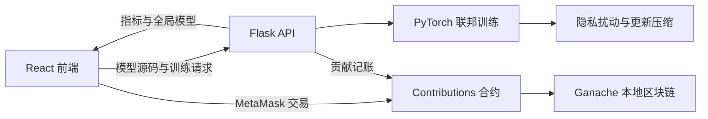

# FedChain

FedChain 是一个面向智慧医疗场景的区块链联邦学习原型。项目通过 Flask/PyTorch 完成本地训练与模型聚合，通过 Solidity 智能合约记录训练请求和节点贡献，并提供 React 页面用于提交模型、查看聚合指标及下载全局模型。

> 本仓库定位为科研与教学原型，不应直接用于生产环境或真实医疗决策。

## 核心能力

- 联邦训练：将样本划分给多个虚拟协作节点，聚合训练全局模型。
- 隐私与压缩：对模型更新执行范数裁剪、自适应高斯扰动、Top-K 稀疏化和 K-Means 量化。
- 链上记账：通过智能合约登记训练请求、贡献代币和奖励余额。
- 可视化交互：上传 `net.py`，展示准确率、通信压缩率、稀疏度和节点贡献占比。
- 同态加密实验：`FLPyfhelin.py` 提供独立的 CKKS/Pyfhel 实验代码，不属于 Web 演示的默认运行链路。

## 系统结构



## 建议公开的目录

```text
.
├── README.md
├── .gitignore
├── truffle-config.js
├── contracts/                  # Solidity 合约源码
├── migrations/                 # Truffle 部署脚本
├── backend/
│   ├── requirements.txt
│   ├── net.py                  # 可上传的模型结构示例
│   ├── flask_app/              # Flask、训练、隐私与合约交互代码
│   └── tests/                  # 隐私/压缩流程测试
├── frontend/my-app/
│   ├── package.json
│   ├── package-lock.json
│   ├── public/                 # 仅保留 CRA 必需的页面和图标
│   └── src/                    # React 源码；合约 JSON 由部署步骤生成
└── FLPyfhelin.py               # 可选的 CKKS 实验
```

本项目不公开数据集、训练结果、依赖目录、链上本地状态或编译产物。详见下文的“数据说明”和根目录 `.gitignore`。

## 环境要求

- Python 3.9（项目原始开发环境为 Python 3.9.20）
- Node.js 14 或 16
- Truffle 5
- Ganache（RPC 地址默认为 `http://127.0.0.1:7545`）
- MetaMask

前端基于 Create React App 3。Node.js 17 及以上版本默认使用 OpenSSL 3，可能触发 `ERR_OSSL_EVP_UNSUPPORTED`；建议直接使用 Node.js 14/16，而不是在正式环境中依赖兼容性参数。

## 数据说明

后端启动时会读取：

```text
backend/flask_app/Data.bin
```

当前本地文件包含 715 条医疗样本、62 个输入特征和标签列 `ICU`。由于项目中没有提供该数据集的来源、许可证和脱敏证明，**请勿将现有 `Data.bin` 上传到公开仓库**。

如需运行演示，请自行准备具有合法使用权限且完成脱敏的数据，并将其保存为 Joblib 序列化的 Pandas `DataFrame`。数据必须包含与 `backend/flask_app/net.py` 输入维度匹配的 62 个数值特征及 `ICU` 标签列。

## 本地运行

以下命令均从仓库根目录开始执行。

### 1. 启动本地区块链

在 Ganache 中创建工作区，监听 `127.0.0.1:7545`，并确保至少有 6 个可用账户。

### 2. 编译并部署合约

```bash
npm install -g truffle@5
truffle compile
truffle migrate --reset --network development
```

部署后，将带有 ABI 和本地网络地址的合约产物复制给前端。PowerShell 示例：

```powershell
Copy-Item .\build\contracts\Contributions.json .\frontend\my-app\src\Contributions.json -Force
```

`build/` 和前端中的 `Contributions.json` 都是可重新生成的产物，不需要提交到 GitHub。

### 3. 启动后端

先把已获授权的数据文件放到 `backend/flask_app/Data.bin`，然后执行：

```powershell
cd backend
python -m venv .venv
.\.venv\Scripts\Activate.ps1
python -m pip install -r requirements.txt
cd flask_app
python -m flask --app app run --host 127.0.0.1 --port 5000
```

启动时后端会连接 Ganache、读取已部署的 `Contributions` 合约并初始化训练数据。健康检查地址为 `http://127.0.0.1:5000/api/status`。

可通过环境变量调整训练参数：

| 变量 | 默认值 | 说明 |
| --- | ---: | --- |
| `WEB3_PROVIDER` | `http://127.0.0.1:7545` | Web3 RPC 地址 |
| `CONTRIBUTIONS_CONTRACT_ADDRESS` | 自动读取部署产物 | 指定合约地址 |
| `FL_WORKERS` | `5` | 虚拟训练节点数 |
| `FL_EPOCHS` | `2` | 训练轮数 |
| `FL_BATCH_SIZE` | `8` | 批大小 |
| `FL_LEARNING_RATE` | `0.01` | 学习率 |
| `FL_KEEP_RATIO` | `0.5` | Top-K 参数保留比例 |
| `FL_QUANTIZATION_BITS` | `4` | 量化位数 |
| `FL_CLIP_NORM` | `1.0` | 更新裁剪阈值 |
| `FL_NOISE_MULTIPLIER` | `0.01` | 扰动强度 |

### 4. 启动前端

```powershell
cd frontend\my-app
npm install
npm start
```

浏览器访问 `http://localhost:3000`。在 MetaMask 中添加 Ganache 网络、导入一个 Ganache 测试账户，并确认网络 ID 与合约部署网络一致。

### 5. 提交模型

页面只接受文件名为 `net.py`、大小不超过 512 KB，且顶层定义了 `Net` 类的 Python 源文件。可使用 `backend/net.py` 作为示例。

后端只校验并记录上传文件的 SHA-256 指纹，不会直接执行上传的源码；实际训练使用服务端已审计的 `backend/flask_app/net.py`。

## API

| 方法 | 路径 | 用途 |
| --- | --- | --- |
| `GET` | `/api/status` | 查看服务、链和隐私流程状态 |
| `POST` | `/api/upload` | 以表单字段 `model_file` 上传 `net.py` 并启动训练 |
| `GET` | `/api/download` | 下载训练生成的 `model.pt` |

## 测试

在后端环境安装依赖后，从仓库根目录执行：

```powershell
python -m unittest discover -s backend\tests -p "test_*.py"
```

## 原型边界

- `backend/flask_app/syft.py` 是为旧版 PySyft 调用方式编写的轻量兼容层，当前 Web 演示在单进程内模拟多个训练节点，并非真实的跨机构分布式部署。
- 当前扰动机制遵循“裁剪 + 噪声”的实验流程，但没有经过正式差分隐私预算审计，不能宣称提供严格的差分隐私保证。
- `FLPyfhelin.py` 的 CKKS 聚合是独立实验，需要额外的 TensorFlow、Keras、Pyfhel 及实验数据，不包含在后端最小依赖中。
- 本地 Ganache 仅用于开发演示；部署到公共链或生产联盟链前，必须重新进行合约安全审计、密钥管理和访问控制设计。

## 许可证

当前项目尚未声明开源许可证。在添加明确的 `LICENSE` 文件之前，默认保留全部权利；其他人可以查看代码，但不应被视为已获得复制、修改或分发授权。
